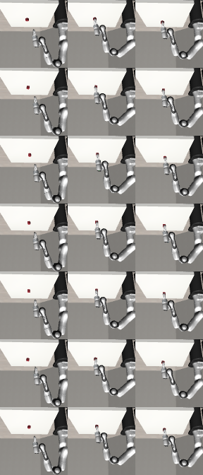

# mujoco-act-panda-lift
基于 MuJoCo 与 LeRobot 的 Panda 机械臂视觉抓取项目，涵盖专家示范采集、ACT 模仿学习训练和闭环仿真评测。
## 阶段 1 · 首条 Panda Lift 专家示范

使用 NVIDIA EGL 和 `hard_reset=False`，在 seed 2000 下成功采集 75 帧。
RGB 图像、机器人状态、动作和时间戳检查通过，五个抽查帧能看到夹爪接近、抓取和抬升过程。

- 原始数据：[episode_002000.npz](data/raw/preview-egl-soft-20261123-193423/episode_002000.npz)
- 复用入口：[collect_panda_lift_soft_reset.py](scripts/collect_panda_lift_soft_reset.py)
- 上游版本：[upstream-commit.txt](evidence/upstream-commit.txt)

## 阶段 2 · 示范质检与 LeRobot 转换

将 7 条专家示范按完整回合划分，逐条检查图像、状态、动作与时间戳是否对齐。转换为 LeRobot 后，回读每条回合的闭合指令帧，核对动作、状态和时间戳。**7 条回合均通过回读检查。**

| 划分 | 种子 | 回合数 | 帧数 |
| --- | --- | ---: | ---: |
| 训练 | `2100–2104` | 5 | 394 |
| 验证 | `2200–2201` | 2 | 161 |

- [第二阶段记录](evidence/d02/stage-2-progress.md) · [回合索引](evidence/d02/episode-index.csv) · [转换验收日志](evidence/d02/lerobot-check.txt)
- [单条检查](scripts/inspect_episode.py) · [批量检查](scripts/audit_d02.py) · [转换与回读](scripts/convert_d02.py)

## 阶段 3 · 自训检查点重载

自训 ACT `step_000100` 从新进程重载后，在 `2300–2302` 的 3 个闭环回合成功 1 次。回放包含接近、闭合和抬升，可核对失败发生的阶段。

## 阶段 4 和 5 · 扩采训练、配对回归与执行步数消融

训练方案对照固定每次执行 20 步。执行步数消融固定 `v1` 权重。两组对照均复用 `1010–1019` 初态。

| 实验 | 配置 | 成功次数 |
| --- | --- | ---: |
| 新旧权重回归 | 旧权重，执行 20 步 | 2/10 |
| 新旧权重回归 | `v1`，执行 20 步 | 5/10 |
| 执行步数消融 | `v1`，执行 1 步 | 2/10 |
| 执行步数消融 | `v1`，执行 5 步 | 5/10 |
| 最终独立评测 | 冻结 `v1` 权重，执行 5 步，种子 `3100–3199` | **37/100** |

同权重消融中，按动作队列估算的整批模型前向次数为 1 步组 2,558 次、5 步组 391 次。总次数同时受执行长度和回合步数影响。

最终评测中，成功回合平均用 77.2 步。63 个失败回合全部达到 300 步上限，其中 34 个回合的方块最大升高小于 1 mm。动作裁剪只出现在夹爪通道。

- [复跑命令、失败分析和证据状态](evidence/v1/final/exec5-3100-3199-20261125-202416/report.md)
- [逐回合 CSV](evidence/v1/final/exec5-3100-3199-20261125-202416/exec5.csv) · [评测汇总](evidence/v1/final/exec5-3100-3199-20261125-202416/eval-summary.txt)
- [v1 采集、训练与配对评测入口](scripts/run_panda_lift_v1.py)
