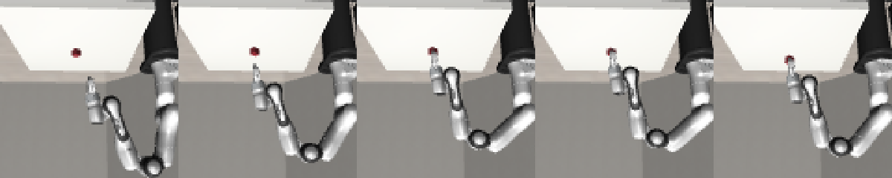

# mujoco-act-panda-lift
基于 MuJoCo 与 LeRobot 的 Panda 机械臂视觉抓取项目，涵盖专家示范采集、ACT 模仿学习训练和闭环仿真评测。
## 阶段 1 · 首条 Panda Lift 专家示范

使用 NVIDIA EGL 和 `hard_reset=False`，在 seed 2000 下成功采集 75 帧。
RGB 图像、机器人状态、动作和时间戳检查通过，五个抽查帧能看到夹爪接近、抓取和抬升过程。

- 原始数据：[episode_002000.npz](data/raw/preview-egl-soft-20261123-193423/episode_002000.npz)
- 复用入口：[collect_panda_lift_soft_reset.py](scripts/collect_panda_lift_soft_reset.py)
- 上游版本：[upstream-commit.txt](evidence/upstream-commit.txt)

## 阶段 2 · 示范质检与 LeRobot 转换

将 7 条专家示范按完整回合划分，逐条检查图像、状态、动作与时间戳是否对齐。转换为 LeRobot 后，回读每条回合的闭合指令帧，核对动作、状态和时间戳。**7 条回合均通过回读检查。**

| 划分 | 种子 | 回合数 | 帧数 |
| --- | --- | ---: | ---: |
| 训练 | `2100–2104` | 5 | 394 |
| 验证 | `2200–2201` | 2 | 161 |

- [第二阶段记录](evidence/d02/stage-2-progress.md) · [回合索引](evidence/d02/episode-index.csv) · [转换验收日志](evidence/d02/lerobot-check.txt)
- [单条检查](scripts/inspect_episode.py) · [批量检查](scripts/audit_d02.py) · [转换与回读](scripts/convert_d02.py)

